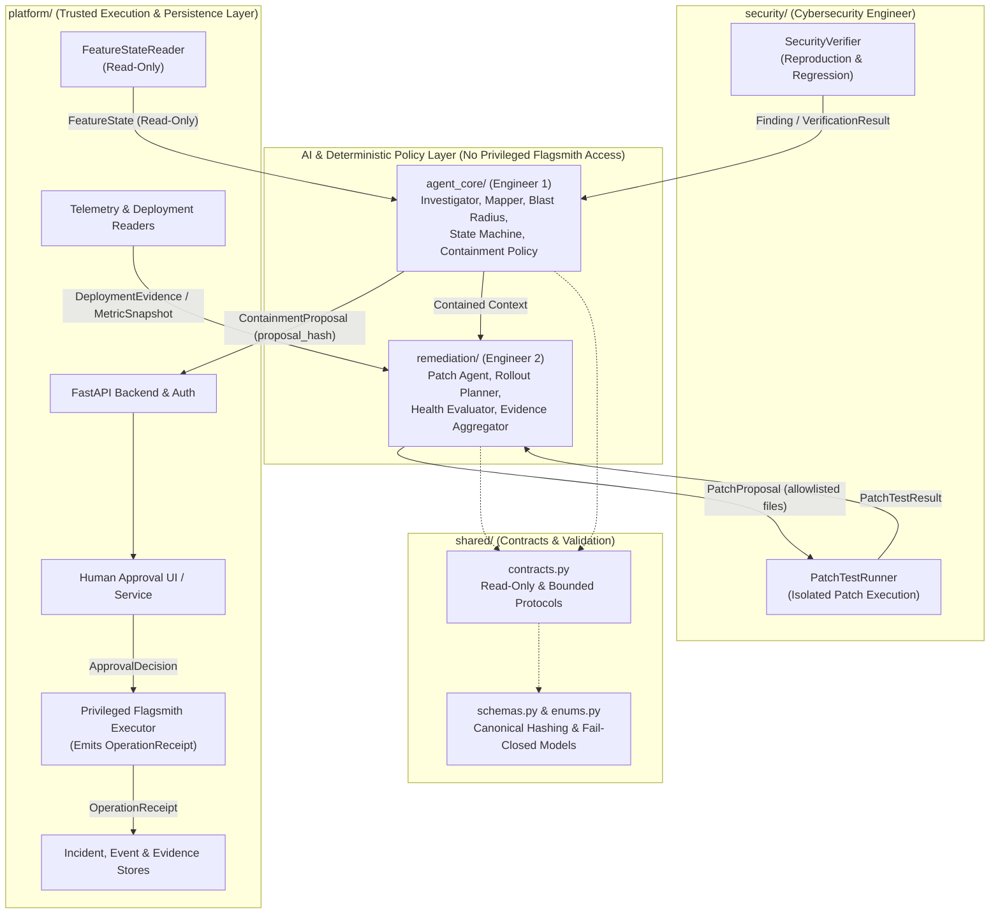

# Killswitch X — System Architecture

> [!NOTE]
> **Specification Audit Notice:** During Phase 01 repository inspection, the external specification documents `00_MASTER_ROADMAP.md`, `01_AI_ML_ENGINEER_1.md`, and `02_AI_ML_ENGINEER_2.md` were **not present** in the repository. This architecture and its shared contracts were established directly from Prompt 01/12 while preserving explicit extension hooks for all four engineering tracks.

## 1. Project Objective

Killswitch X is an AI-assisted, evidence-driven cybersecurity incident containment, remediation, and recovery platform. It coordinates authorized vulnerability verification, deterministic feature-flag containment via Flagsmith (with mandatory human approval), isolated source-patch verification, and progressive guardrail-governed recovery, culminating in an auditable `EvidenceReport`.

Operational safety, deterministic state control, and verifiable evidence strictly outrank AI autonomy.

## 2. Module Hierarchy & Team Ownership

| Directory | Owner | Responsibility | Phase 01 Status |
| :--- | :--- | :--- | :--- |
| [`shared/`](../shared/) | Shared Foundation | Enums, Pydantic schemas, contracts, config, exceptions, IDs, hashing, logging, fixtures | Implemented & verified |
| [`agent_core/`](../agent_core/) | AI/ML Engineer 1 | State machine, orchestrator, guards, replay, idempotency, retry, investigator, mapper, blast radius | Phase 02 orchestration implemented; AI intelligence deferred |
| [`remediation/`](../remediation/) | AI/ML Engineer 2 | Patch agent, patch tests, rollout planner, rollback recommender, evidence report | Package boundary only |
| [`security/`](../security/) | Cybersecurity Engineer | Scanner adapters, reproduction, regression tests, isolated runner | Ownership README & contracts |
| [`platform/`](../platform/) | Full-stack & Cybersecurity Engineer | FastAPI API, Flask demo app, React UI, DB persistence, Flagsmith executor, approvals | Ownership README & contracts |
| [`config/`](../config/) | Shared Configuration | Route registry, illustrative dependency graph, rollout policy defaults | Fixture configs created |

> [!IMPORTANT]
> `platform/` intentionally contains **no** `__init__.py` so it never shadows Python's standard-library `platform` module.

## 3. High-Level System Architecture & Trust Boundaries

## 4. Incident Lifecycle & Data Flow

```mermaid
flowchart LR
    A["1. Finding Received"] --> B["2-3. Reproduce & Verify"]
    B --> C["4-6. Investigate, Map Flag & Analyze Graph"]
    C --> D["7-8. Evaluate Options & Propose Containment"]
    D --> E["9. Human Approval (Exact proposal_hash)"]
    E --> F["10-11. Authorized Flagsmith Execution & Readback"]
    F --> G["12-13. Repeat Security Regression -> CONTAINED"]
    G --> H["14-15. Candidate Patch & Isolated Patch Tests"]
    H --> I["16. Verify Deployment Evidence"]
    I --> J["17-18. Progressive Rollout (5/25/50/100%) & Health Eval"]
    J -->|"Guardrail Breach / Missing Data"| K["19. Propose Rollback / Hold"]
    J -->|"All Stages Healthy"| L["20. Export EvidenceReport"]
```

## 5. Boundary Definitions

### 5.1 AI Reasoning Boundary
- LLM outputs (`InvestigationSummary`, `PatchProposal`) are untrusted until parsed into strict Pydantic models (`extra="forbid"`) and checked by deterministic policies.
- `AIServiceSettings` (`KILLSWITCH_*`) contains zero database credentials, zero approval signing secrets, and zero Flagsmith management tokens.

### 5.2 Authorization Boundary
- AI modules only hold `FeatureStateReader` (4 read-only methods).
- Privileged Flagsmith changes require:
  1. Valid `ContainmentProposal` (`approval_required=True`, valid canonical `proposal_hash`).
  2. Authenticated `ApprovalDecision` matching `proposal_id`, `incident_id`, `proposal_hash`, `decision="approved"`, and non-expired timestamps.
  3. Execution by the platform layer emitting an `OperationReceipt` with `provenance != "llm_interpretation"` and readback confirmation.

### 5.3 Evidence Flow
- Every artifact is referenced via `ArtifactReference` with a 64-character lowercase SHA-256 `content_hash` and explicit `EvidenceProvenance` (`actual_observed`, `security_test_output`, `external_operation_receipt`, `llm_interpretation`, `deterministic_reasoning`, `synthetic_telemetry`, `reference_fixture`, `manual_operator_input`).

## 6. Architecture Decision Records & Orchestration Docs

- [`docs/orchestration.md`](./orchestration.md) — Central orchestrator, pipeline, dependency injection, and simulations.
- [`docs/state_machine.md`](./state_machine.md) — Complete state machine, transitions, guards, and Mermaid diagram.
- [`docs/event_catalog.md`](./event_catalog.md) — Event taxonomy, producers, consumers, and state effects.
- [`docs/approval_lifecycle.md`](./approval_lifecycle.md) — Proposal binding, human approval checks, and executor boundary.
- [`docs/replay_and_idempotency.md`](./replay_and_idempotency.md) — Optimistic concurrency, replay engine, and durable persistence requirements.
- [`docs/orchestration_failure_modes.md`](./orchestration_failure_modes.md) — Explicit failure routing and bounded retry policies.
- [`docs/decisions/`](./decisions/) — ADR-001 through ADR-009.
