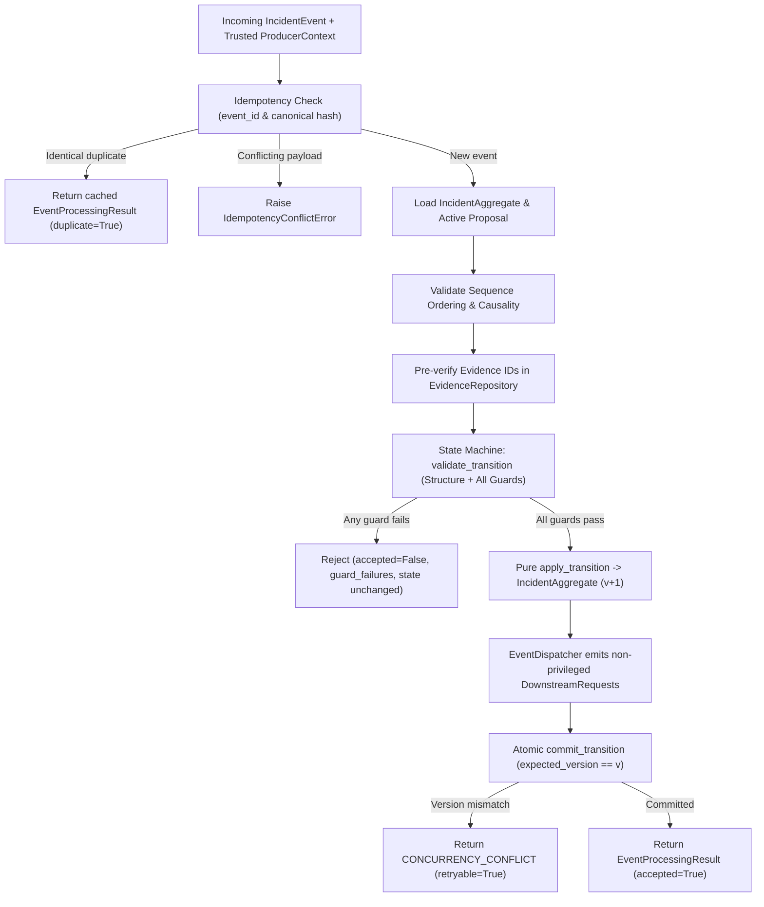

# Killswitch X — Incident Orchestration Architecture

## 1. Overview

The central orchestration subsystem in [`agent_core/`](../agent_core/) coordinates every incident from initial vulnerability intake through verified containment, isolated patch testing, progressive recovery, and final evidence reporting.

All transitions are **deterministic and evidence-gated**. An LLM or future AI agent may recommend investigations, mappings, containment proposals, or candidate patches, but **only** the state machine and transition guards in `agent_core` can advance incident state, and **only** the trusted platform executor can mutate Flagsmith after authenticated human approval.

## 2. Core Components

| Module | Responsibility |
| :--- | :--- |
| [`agent_core/orchestrator.py`](../agent_core/orchestrator.py) | `IncidentOrchestrator`, `on_incident_event`, `analyze_incident` coordinating pipeline, evidence pre-checks, atomic commits, and future AI protocols |
| [`agent_core/state_machine.py`](../agent_core/state_machine.py) | Structural checks (`can_transition`, `get_target_state`, `get_allowed_events`), guard invocation (`validate_transition`), pure updates (`apply_transition`) |
| [`agent_core/transitions.py`](../agent_core/transitions.py) | Centralized `TRANSITION_RULES`, `NON_TRANSITION_RULES`, `EVIDENCE_REQUIREMENTS`, and Mermaid generator |
| [`agent_core/guards.py`](../agent_core/guards.py) | 20 fail-closed guard evaluators returning structured `GuardResult` objects |
| [`agent_core/incident.py`](../agent_core/incident.py) | Frozen `IncidentAggregate` preventing arbitrary state assignment (`with_transition()`) |
| [`agent_core/events.py`](../agent_core/events.py), `event_handlers.py`, `event_dispatcher.py` | Event classification, ordering/causality checks, and non-executing `DownstreamRequest` emission |
| [`agent_core/evidence_validator.py`](../agent_core/evidence_validator.py) | Repository existence/incident binding, SHA-256 checks, producer auth, live-vs-fixture provenance enforcement |
| [`agent_core/approval_validator.py`](../agent_core/approval_validator.py) | Authenticated human operator checks, canonical `proposal_hash` binding, clock freshness, feature drift, single-use consumption |
| [`agent_core/idempotency.py`](../agent_core/idempotency.py) & [`replay.py`](../agent_core/replay.py) | Canonical payload hashing, stable operation keys, and side-effect-free historical replay |
| [`agent_core/retry_policy.py`](../agent_core/retry_policy.py) | Bounded retries, backoff/deadlines, and `RECONCILIATION_REQUIRED` for unknown privileged writes |
| [`agent_core/repositories/memory.py`](../agent_core/repositories/memory.py) | Atomic in-memory reference repository for offline development and testing |
| [`agent_core/policies.py`](../agent_core/policies.py) | Deterministic validation of injected AI agent outputs before acceptance |

## 3. Event Processing Pipeline



## 4. Dependency Injection for Future Subsystems

`IncidentOrchestrator` accepts optional protocol implementations defined in [`agent_core/context.py`](../agent_core/context.py):
- `InvestigatorAgent` (`run_investigation`)
- `FeatureMapperAgent` (`run_mapping`)
- `ContainmentStrategistAgent` (`run_containment_strategy`)
- `PatchEngineerAgent`, `ReleaseManagerAgent`, `EvidenceReporterAgent`

All injected outputs are validated by [`agent_core/policies.py`](../agent_core/policies.py) before entering workflow state. Offline development uses explicitly labeled fixture adapters in [`agent_core/adapters/fixtures.py`](../agent_core/adapters/fixtures.py).

## 5. Running Reproducible Synthetic Simulations

All simulations run offline using `REFERENCE_FIXTURE` and `SYNTHETIC_TELEMETRY` data and emit zero live execution requests (`executable_live=False`):

```bash
.venv/bin/python -m agent_core.simulations
```

Simulations covered:
- **Simulation A:** Complete SQLi incident (`RECEIVED` → `RECOVERED` across 5/25/50/100% stages)
- **Simulation B:** Rejected containment proposal (`REJECTED`, 0 execution requests)
- **Simulation C:** Invalid hash & expired approval denied (`AWAITING_APPROVAL`)
- **Simulation D:** Failed post-containment regression (`CONTAINMENT_FAILED`)
- **Simulation E:** Failed functional patch test (`PATCH_FAILED`)
- **Simulation F:** Synthetic rollout health breach (`ROLLBACK_PROPOSED`, 0 unapproved rollbacks)
- **Simulation G:** Duplicate event idempotency (`APPLYING`, 1 logical operation)
- **Simulation H:** Deterministic incident replay parity
