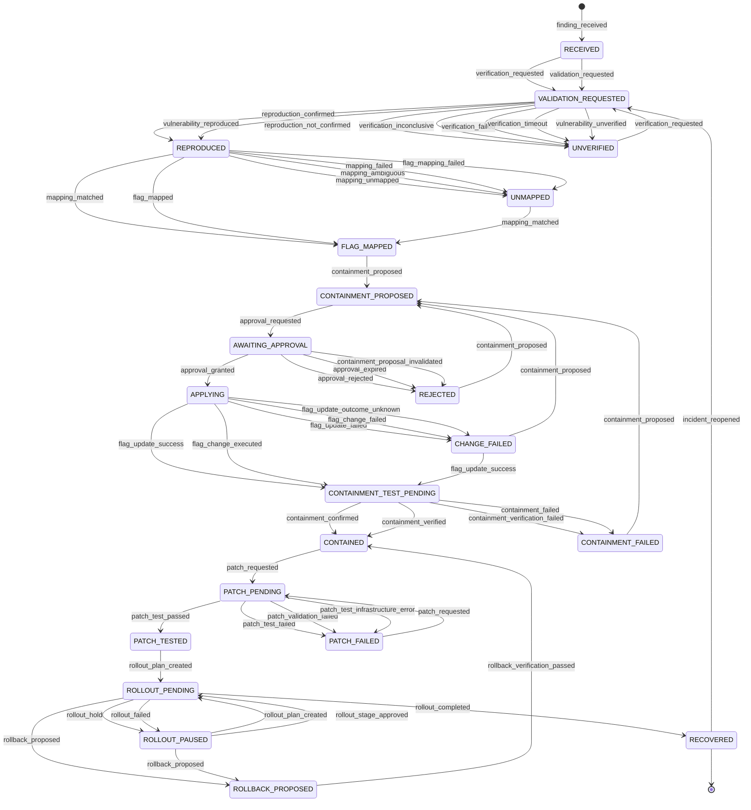

# Killswitch X — Incident State Machine

The authoritative transition table and non-transition event rules live in [`agent_core/transitions.py`](../agent_core/transitions.py) and are evaluated by [`agent_core/state_machine.py`](../agent_core/state_machine.py).

## 1. Status Separation

Killswitch X strictly separates eight distinct status concepts rather than collapsing them into one field:
1. **Incident Lifecycle State (`IncidentState`):** Top-level orchestration state (`RECEIVED` .. `RECOVERED` / failure states).
2. **Vulnerability Finding Status (`FindingStatus`):** `suspected` vs. `reproduced`.
3. **Approval Status (`ApprovalStatus`):** `pending`, `approved`, `rejected`, `expired`, `invalidated`.
4. **External Operation Outcome (`OperationOutcome`):** `succeeded`, `failed`, `rejected`, `timed_out`, `unknown`.
5. **Patch Lifecycle Status (`PatchStatus`):** `patch_proposed`, `patch_tested`, `patch_failed`, `patch_deployed`.
6. **Deployment Status (`DeploymentStatus`):** `observed`, `pending`, `failed`, `missing`, `unknown`.
7. **Rollout Stage (`RolloutStageRecord.status`):** Subordinate per-percentage tracking (`5%`, `25%`, `50%`, `100%`) inside `ROLLOUT_PENDING`.
8. **Evidence Completeness (`EvidenceCompleteness`):** `complete`, `partial`, `incomplete`.

## 2. State Diagram (Generated from `TRANSITION_RULES`)

## 3. Non-Transition Context Events

Events in `NON_TRANSITION_RULES` update `IncidentAggregate` metadata without changing `current_state`:
- `investigation_completed`, `investigation_requested`, `investigation_failed`, `mapping_requested`
- `execution_requested`, `execution_accepted`, `flag_state_observed`
- `containment_verification_requested`, `containment_verification_passed`, `functional_smoke_test_passed`, `functional_smoke_test_failed`
- `patch_proposed`, `patch_test_requested`, `patch_test_completed`, `deployment_observed`, `patch_deployment_observed`
- `rollout_stage_proposed`, `rollout_stage_approved`, `rollout_stage_applied`, `rollout_stage_observed`, `rollout_metrics_received`, `rollout_advance_proposed`, `rollout_decision_recorded`
- `rollback_approved`, `rollback_rejected`, `rollback_applied`, `rollback_verification_failed`
- `operation_retry_requested`, `operation_retry_exhausted`, `integration_unavailable`, `manual_review_requested`, `approval_invalidated`, `evidence_exported`

## 4. Terminal & Reopening Behavior

`RECOVERED` permits **only** non-transition diagnostic/export events (`evidence_exported`, `manual_review_requested`) and one explicit audited reopening transition (`incident_reopened` → `VALIDATION_REQUESTED`) guarded by `evidence_existence` when newly verified evidence invalidates recovery.
