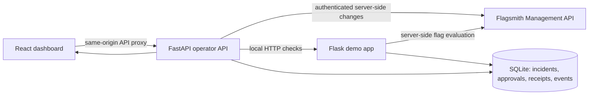

# Veto-Switch platform demo

This local-only demonstration connects the synthetic Flask application, an authenticated FastAPI operator service, SQLite evidence storage, Flagsmith, and the React dashboard. It demonstrates **security containment and safe feature rollout**; it does not protect production traffic.

## Start the application

From the repository root in PowerShell:

```powershell
if (-not (Test-Path .env)) { Copy-Item .env.example .env }
docker compose up --build
```

Open the dashboard at `http://127.0.0.1:3000`. The synthetic demo app is at `http://127.0.0.1:5000`; the API reference is at `http://127.0.0.1:8000/docs`. Compose binds all host ports to loopback. The application containers run as an unprivileged user and use a persistent Docker volume.

To stop the services, press **Ctrl+C**. `docker compose down` removes containers but keeps the demo volume. The dashboard's **Reset local demo** control clears local incidents, decisions, telemetry and local overrides, then restores the safe flag defaults. Reset is rejected when the real Flagsmith adapter is selected.

The demo is deliberately isolated from the public internet. Never publish these ports or use the synthetic vulnerable routes with real data.

## Connect Flagsmith

The local SQLite adapter works without a Flagsmith account. The real adapter requires a dedicated development environment with four flags:

| Flag | Purpose | Starting environment state |
| --- | --- | --- |
| `search_v1` | Demonstration-only vulnerable search | Enabled only when intentionally demonstrating the issue |
| `search_v2` | Parameterized safe search | Disabled by default; enabled only for approved identity stages |
| `files_v1` | Demonstration-only traversal example | Enabled only when intentionally demonstrating the issue |
| `files_v2` | Safe synthetic file reader | Disabled by default; enabled only for approved identity stages |

In the private, ignored `.env`, set `KILLSWITCH_FLAG_ADAPTER=flagsmith` and fill in `KILLSWITCH_PLATFORM_FLAGSMITH_ENVIRONMENT_KEY`, `KILLSWITCH_PLATFORM_FLAGSMITH_SERVER_ENVIRONMENT_KEY`, and `KILLSWITCH_PLATFORM_FLAGSMITH_MANAGEMENT_TOKEN`. The Management API token is server-only and must never be pasted into chat, put in frontend files, or committed. The SDK environment key is also kept on the server for this demo.

If a required flag is missing or ambiguous, the API returns a capability error and coverage shows an unknown state. Create or correct the flag in Flagsmith, then refresh the dashboard. Flag evaluation is confirmed by calling the running demo app after Management API readback; if the SDK has not observed the change, the result stays failed or unknown. Management requests use bounded retries for transient errors.

Each demo route evaluates its related flags in one server-side Flagsmith read and returns the observed `flag_states`. A safe fallback remains available when evaluation is unknown, but the operator API records verification as unknown rather than claiming the flags were confirmed off.

The management adapter uses Flagsmith's private Management API; it detects versioned environments and reads/writes identity overrides through the live edge-identity API. The demo app evaluates flags on the server. Keep the Management API credential out of the browser. See the [Flagsmith Management API documentation](https://docs.flagsmith.com/integrating-with-flagsmith/flagsmith-api-overview/management-api) and [authentication guidance](https://docs.flagsmith.com/integrating-with-flagsmith/flagsmith-api-overview/management-api/authentication).

### Flagsmith troubleshooting

- If `/flags/coverage` reports `unknown` or a gap, confirm the four feature names exist in the selected Development environment and the private `.env` points to that same environment. Feature creation is manual in this demo.
- If the Management API rejects a read or update, keep the incident unverified. Check the Management API credential and environment permissions in Flagsmith, update the ignored `.env` locally if needed, then restart Compose. Never copy the credential into a report, screenshot, browser code or chat.
- If Management API readback succeeds but the demo app still reports the previous variant, treat verification as pending/failed and retry after the Flagsmith SDK observes the update. Do not call the change contained until the app evaluation and the post-change check both pass.
- If a staged rollout observes a known identity guardrail violation, the incident stores the failed identities and a `rollback_proposed` recommendation. If flag evaluation is unknown, it records the affected identities as unknown and recommends retrying verification first. Rollback remains a separate proposal with its own approval; no automatic rollback occurs.
- If a rollback reports an API 404 while an override has already disappeared, compare the identity's current Flagsmith state and the demo app's live evaluation before retrying. The adapter treats a delete 404 as successful only when a fresh read confirms the override is absent; any remaining or unreadable state stays failed/unknown.

## Demo safety settings

Vulnerable examples require both `KILLSWITCH_DEMO_MODE=true` and `KILLSWITCH_ALLOW_VULNERABLE_ROUTES=true`, and each vulnerable flag must be enabled. These gates allow only synthetic examples. Do not use them outside the local demo.

The normal `/search` and `/files` routes use the currently enabled safe variant, or a safe fallback. The `/demo/search-v1` and `/demo/files-v1` routes are hidden unless the vulnerable gates and corresponding flags are enabled. The file demonstration reads only a fixed in-memory synthetic file set; it never reads arbitrary disk paths.

Each normal route accepts an optional `identity=demo_user_01` through `identity=demo_user_20` query parameter. Unknown identities are rejected. The Flask app logs only route, selected variant, synthetic identity and outcome; it does not save request query strings or file contents in telemetry.

## Operator flow

1. Connect with the passphrase in `.env`.
2. Create a synthetic incident in the dashboard, or submit a normalized finding to `POST /findings`.
3. Analyze the finding. The API observes a before-change result and prepares a 15-minute proposal bound to the exact flag state and environment.
4. Approve or reject that exact proposal. Applying it turns **off only the vulnerable flag**. The safe flag stays unchanged, so the route falls back safely while the safe alternative remains separately controlled.
5. Run verification. The dashboard reports containment only when Management API readback and actual demo-app observations confirm the safe outcome and unaffected `/status` is healthy.
6. View the safe code diff and run fixed, built-in synthetic security and functionality checks. The patch endpoint does not run arbitrary commands and does not claim to deploy code.
7. Prepare a 5%, 25%, 50%, or 100% safe-variant stage. With 20 fixed identities, stages target 1, 5, 10, or 20 users (5% rounds up to one). Review the proposal hash and exact identities, then approve and apply it as a separate operation. Flagsmith identity overrides are read back and the running app is called for every seeded identity.
8. A rollback is another proposal. It requires its own approval before it restores the previous identity overrides.
9. Review the persisted timeline, synthetic telemetry and JSON evidence report.

The primary state-changing endpoints require `X-Operator-Passphrase`. Approval and application are separate requests. The backend rejects missing or wrong authentication, rejected/expired/stale proposals, changed hashes, wrong environments and duplicate in-progress operations. Reports and event streams use the same operator authentication. This passphrase is only for a local demonstration; production needs real user accounts and stronger authentication.

## Normalized finding contract

`POST /findings` accepts a stable JSON object such as:

```json
{
  "finding_id": "scanner-run-17-item-3",
  "category": "sqli",
  "affected_route": "/search",
  "severity": "high",
  "status": "reproduced",
  "evidence_ids": ["synthetic-check-3"],
  "evidence_summary": "The synthetic search check returned records unexpectedly.",
  "reporter": "security-agent"
}
```

Supported categories map to the isolated search injection and path traversal scenarios. Dependency-CVE and other categories are stored for review but have no automatic demo action mapping. Suspected findings cannot be analyzed until reproduced. Repeated `finding_id` submissions return the original incident.

## API and operational checks

- `GET /health` — adapter and local reset capability (no secrets).
- `GET /flags`, `GET /flags/coverage` — server-observed flag states and route mapping.
- `POST /incidents`, `POST /findings`, `GET /incidents` — finding intake and persisted queue.
- `POST /incidents/{id}/analyze` — before-change evidence and a bound containment proposal.
- `POST /proposals/{id}/decision`, `POST /proposals/{id}/apply` — approval and containment.
- `POST /incidents/{id}/verify`, `POST /incidents/{id}/patch`, `POST /incidents/{id}/patch/test` — post-change checks, diff and fixed tests.
- `POST /incidents/{id}/rollout`, `POST /release-proposals/{id}/decision`, `POST /release-proposals/{id}/apply` — separately approved staged targeting.
- `POST /incidents/{id}/rollouts/{release_id}/rollback` — prepare a separately approved rollback.
- `GET /incidents/{id}/events`, `GET /incidents/{id}/events/stream` — persisted events with SSE delivery; the dashboard also polls as a fallback.
- `GET /telemetry`, `POST /telemetry/generate` — privacy-limited observations and bounded synthetic traffic (1–500 requests).
- `GET /incidents/{id}/report` — authenticated JSON evidence export.
- `POST /demo/reset` — local SQLite only; unavailable in Flagsmith mode.

Interactive OpenAPI docs are available at `http://127.0.0.1:8000/docs`. The same-origin dashboard proxy forwards requests to the API; no CORS allowlist is needed for the normal Compose setup.

## Reproducible local smoke check

With the stack running and local demo mode enabled in `.env`:

```powershell
& .\.venv\Scripts\python.exe platform\scripts\smoke.py
```

The script exercises finding intake, containment, verification, patch tests, a 5% stage, approved rollback and report generation. For a real Flagsmith adapter, it refuses by default. You must add `--allow-real-flagsmith` and type a separate approval phrase for each real change. Real runs require all four flags, enabled vulnerable-demo gates, the disabled safe-flag default and Management API write permission. The script intentionally leaves its incident and audit evidence for review.

To create the Python environment and run tests outside Docker:

```powershell
python -m venv .venv
& .\.venv\Scripts\python.exe -m pip install -r platform\requirements.txt
$env:PYTHONPATH = "$PWD\platform"
& .\.venv\Scripts\python.exe -m pytest platform\demo_app\tests platform\backend\tests -q
```

## Architecture



## Acknowledgments and license

This demo uses Flask, FastAPI, Flagsmith, React, Vite, SQLite and nginx. Their names and software remain the property of their respective maintainers. The repository currently has no `LICENSE` file; the repository owner/team must choose and add a license before presenting the source as open source.

## Limits and handoff

- The data, identities, test traffic and affected-user counts are synthetic. There is no production or customer telemetry.
- Only SQL injection and path traversal have a safe mapped response in this branch. Other normalized categories remain stored but cannot trigger flag changes.
- Flag creation is not automated. Create the four features in the dedicated Flagsmith demo project if coverage reports them missing.
- The patch diff compares demonstration source files. The safe code is already in the demo image; the diff is an explanation and is not deployed by the patch endpoint.
- External advisories, team-agent services, production authentication and deployment to a hosted environment are not connected here.
- The final UI screenshots, 90–150 second hackathon video and submission link must be captured, playback-checked and supplied by the team; the local smoke script provides a repeatable sequence to record.
- The other agent lanes' GraphQL/advisory services are not connected here. This platform publishes a normalized `POST /findings` contract; the team must map their live service output to it after that endpoint/schema is available.
